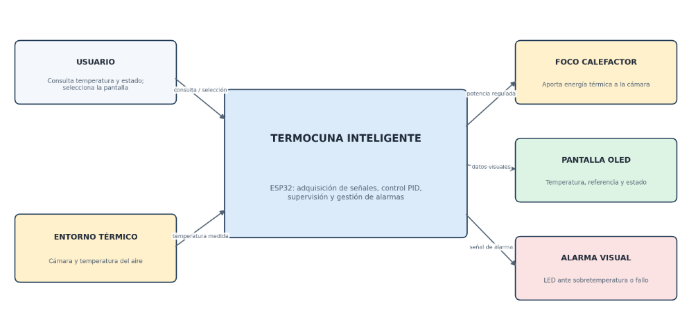
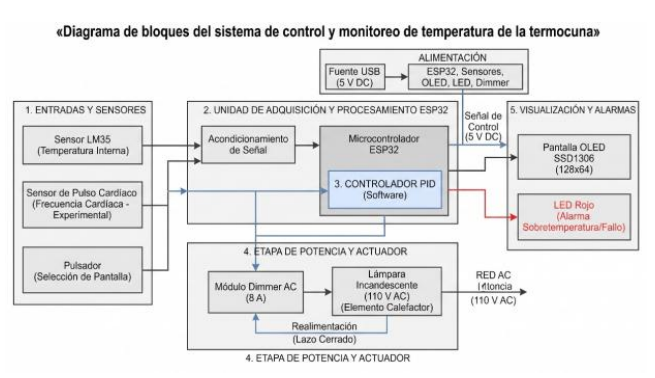
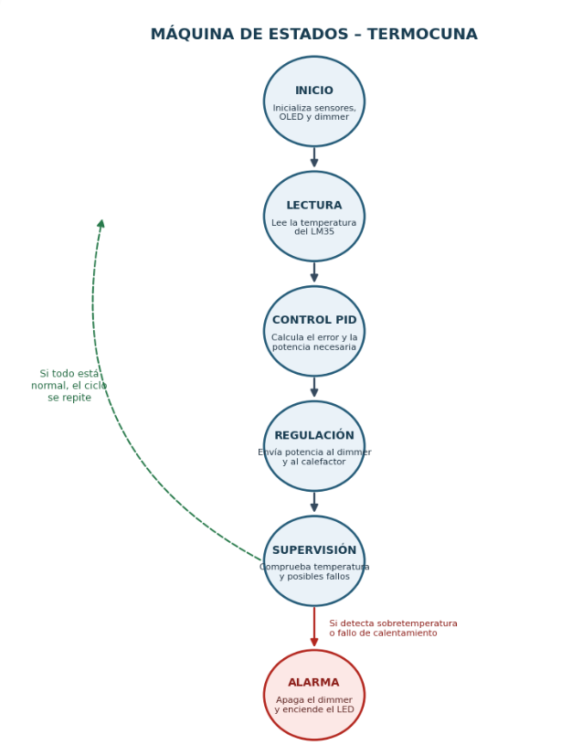

# Sistema de regulación térmica mediante control PID basado en ESP32

## 1. Introducción

El proyecto consiste en el diseño e implementación de un prototipo de termocuna inteligente, cuyo objetivo principal es regular y supervisar la temperatura interna de una cámara térmica mediante un sistema de control automático basado en un microcontrolador ESP32.

El sistema utiliza un sensor LM35 para medir la temperatura, un controlador PID digital para calcular la acción de control y un módulo dimmer RobotDyn para regular la potencia eléctrica suministrada a un foco calefactor. Además, incorpora una pantalla OLED para visualizar las variables de funcionamiento y un sistema de protección por sobretemperatura.

## 2. Alcance y limitaciones

### 2.1. Alcance del proyecto

El proyecto contempla el desarrollo de un sistema embebido capaz de medir, regular y visualizar la temperatura de una cámara térmica mediante un controlador PID implementado en el ESP32.

Las principales funciones del sistema son:

- Adquisición de temperatura mediante un sensor analógico LM35 conectado al ESP32.
- Implementación de un controlador PID digital con acciones proporcional, integral y derivativa.
- Regulación de la potencia del foco calefactor mediante un módulo dimmer RobotDyn, sincronizado con la señal de cruce por cero de la alimentación de corriente alterna.
- Visualización de la temperatura y de las condiciones de funcionamiento mediante una pantalla OLED I2C.
- Implementación de una protección por sobretemperatura, establecida mediante un límite superior respecto al valor de referencia.
- Incorporación de un sensor de frecuencia cardíaca y un botón físico para alternar entre las pantallas de visualización.

### 2.2. Limitaciones del proyecto

El sistema se desarrolla como un prototipo experimental, por lo que su precisión depende de las características de los sensores, su calibración, la ubicación dentro de la cámara y las condiciones ambientales.

El control PID regula la temperatura medida en el punto donde se encuentra instalado el sensor, por lo que no garantiza que exista una distribución térmica uniforme en todo el espacio interno.

El prototipo no constituye un dispositivo médico ni está destinado a utilizarse con recién nacidos.

## 3. Diagrama de contexto

El diagrama de contexto representa la interacción entre el sistema de regulación térmica, el usuario y los elementos externos que intervienen en su funcionamiento.

## 4. Diagrama de bloques del diseño

El sistema está compuesto por una etapa de medición, una etapa de procesamiento y control, una etapa de actuación y una interfaz de visualización.

El sensor LM35 proporciona la medición de temperatura al ESP32. El controlador PID procesa esta información y determina la potencia que debe suministrarse al foco calefactor mediante el módulo dimmer RobotDyn.

## 5. Máquina de estados

La máquina de estados describe la secuencia de funcionamiento del sistema, desde su inicialización hasta la regulación continua de la temperatura.

El ESP32 realiza la lectura del sensor, ejecuta el algoritmo PID y actualiza la potencia del elemento calefactor. Durante este proceso, supervisa las condiciones de seguridad y puede activar el estado de alarma cuando detecta una condición anormal.

## 6. Interfaces

El sistema dispone de diferentes interfaces eléctricas y de interacción entre sus componentes.

| Interfaz | Conexión | Función |
|---|---|---|
| ESP32 – LM35 | GPIO34 | Adquisición de la señal analógica de temperatura. |
| ESP32 – Dimmer RobotDyn | GPIO25 (ZC) y GPIO26 (PSM) | Sincronización y control de potencia del foco. |
| ESP32 – Pantalla OLED | GPIO21 (SDA) y GPIO22 (SCL) | Comunicación I2C con la pantalla, dirección 0x3C. |
| ESP32 – Sistema de alarma | GPIO27 | Control de un LED indicador mediante una resistencia limitadora de corriente. |
| ESP32 – Sensor de frecuencia cardíaca | GPIO35 | Adquisición de la señal analógica para estimar la frecuencia cardíaca. |
| ESP32 – Botón físico | GPIO32 | Alternancia entre las pantallas de temperatura y frecuencia cardíaca. |

## 7. Alternativas de diseño

Para desarrollar el sistema de regulación térmica se consideraron diferentes alternativas relacionadas con el procesamiento, la medición de temperatura y la actuación sobre el elemento calefactor.

En cuanto al procesamiento, se seleccionó el ESP32 debido a su capacidad de procesamiento, sus entradas analógicas, sus salidas digitales y la disponibilidad de periféricos que permiten gestionar simultáneamente los sensores, el controlador y la interfaz de visualización.

Para la regulación térmica se implementó un controlador PID digital cuyos parámetros fueron obtenidos durante el diseño y ajuste del controlador.

### 7.1. Parámetros del controlador PID

| Parámetro | Valor |
|---|---:|
| Kp | 4.875 |
| Ki | 0.25 |
| Kd | 22.5625 |
| Tf | 0.5 |
| Ts | 1 s |

## 8. Plan de pruebas y validación

La validación del prototipo contempla pruebas individuales y pruebas de funcionamiento integrado.

| Prueba | Criterio esperado |
|---|---|
| Encendido e inicialización | El ESP32 inicia correctamente y reconoce los módulos conectados. |
| Lectura del LM35 | La temperatura presentada corresponde a la señal adquirida por el sensor y mantiene lecturas estables. |
| Funcionamiento del PID | El controlador calcula la salida de acuerdo con el error entre la referencia y la temperatura medida. |
| Regulación del dimmer | El foco modifica su intensidad de calentamiento de acuerdo con la potencia de control. |
| Estabilización térmica | La temperatura se aproxima al valor de referencia y presenta un comportamiento estable. |
| Protección por sobretemperatura | Al alcanzar el límite configurado, se desactiva el calentamiento y se activa la alarma. |
| Detección de fallo de calentamiento | El sistema identifica una condición persistente de calentamiento insuficiente según los criterios programados. |
| Pantalla OLED | Se visualizan correctamente la temperatura, la referencia y los estados del sistema. |
| Botón de selección | El botón permite alternar entre las pantallas sin detener el control de temperatura. |

El sistema se considerará validado para su propósito experimental cuando complete satisfactoriamente las pruebas definidas, registre los resultados obtenidos y demuestre un comportamiento reproducible bajo las condiciones de ensayo.

La evidencia se documentará mediante registros seriales, mediciones de temperatura, observaciones del comportamiento del foco, fotografías del montaje y capturas de la pantalla OLED.

## 9. Consideraciones éticas y de seguridad

Debido a que el proyecto está inspirado en el funcionamiento de una termocuna, es necesario considerar que el control de temperatura constituye una función crítica. Una regulación incorrecta puede ocasionar condiciones térmicas peligrosas, por lo que el prototipo debe evaluarse bajo condiciones controladas y sin exponer a personas a riesgos.

La protección por software implementada en el ESP32 permite desconectar el calentamiento cuando se detecta una condición de sobretemperatura o un fallo de funcionamiento. Sin embargo, esta protección no debe considerarse suficiente por sí sola.

Para una aplicación real sería necesario incorporar mecanismos independientes, como fusibles térmicos, dispositivos de desconexión adecuados y supervisión de fallos del hardware.
